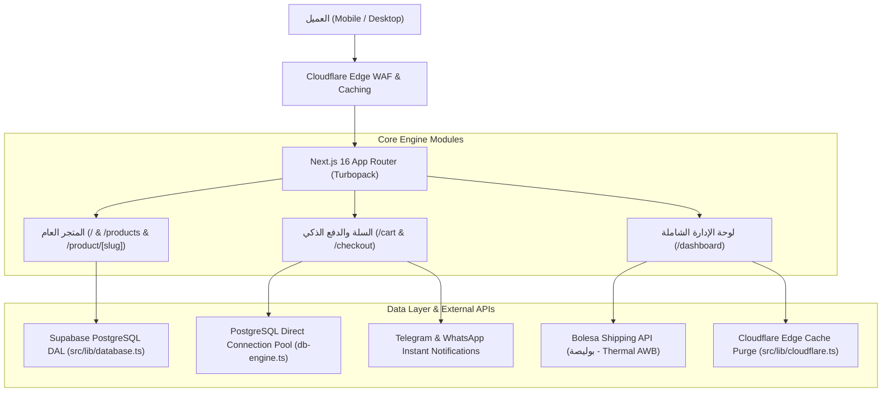

# 🏗️ SH BAKHUR — System Architecture & Technical Blueprint

> **Application:** Luxury E-Commerce Platform for Oud & Fragrances  
> **Production Domain:** `shbakhur.com`  
> **Framework:** Next.js 16.2.2 (App Router) + React 19.2.4 + Tailwind CSS v4  

---

## 1. High-Level Architecture

---

## 2. Core Subsystems
1. **Storefront & Catalog:**
   - Multi-category Swiper sliders, responsive hero slider, dynamic trust features, live product search.
2. **Database Access Layer (DAL):**
   - Centralized queries in `src/lib/database.ts` managing `products`, `categories`, `orders`, `customers`, `discounts`, and `site_settings`.
3. **Logistics & Thermal Printing:**
   - Real-time AWB generation via Bolesa API (`src/app/api/shipping/bolesa/create`).
   - Dynamic tax invoice PDF generation (`InvoiceModal.tsx`) with barcode and QR.
4. **Immediate Milestone 2 Priorities:**
   - Direct digital payment gateway integration (Mada, Apple Pay, Visa, Tabby/Tamara).
   - Automated abandoned cart recovery via WhatsApp webhooks.
   - Meta Conversions API (CAPI) & TikTok Pixel tracking.
